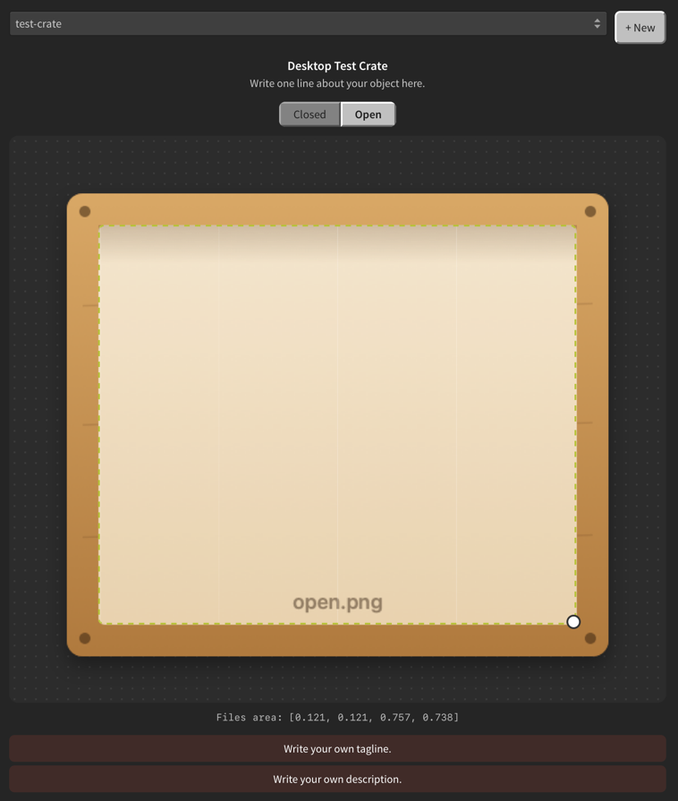

# Desktop Objects Studio for Phoenix Code

Make [Desktop Objects](https://github.com/Electrofist/desktop-objects) in [Phoenix Code](https://phcode.dev): real-feeling Mac desktop apps that hold your files, like a fridge or a drawer.

<p align="center"></p>

## What it does

- **Live preview.** A side panel shows the object you are working on: its icon, name, tagline and colour, and its closed and open art.
- **Place the files area by hand.** Where stored files appear (`look.itemsArea`) is drawn over the open art. Drag it to move it, drag the corner to resize it, and `object.json` updates as you go. Undo works as usual.
- **Problems as you type.** Mistakes in `object.json` are marked in the editor and listed in the Problems panel and the side panel, using the same rules the Desktop Objects repo checks on every pull request.
- **New Desktop Object.** File, New Desktop Object… creates `objects/<your-object>/` from the repo's template, fills in the names and adds you as its owner. No Terminal needed.

## Use it

1. Install **Desktop Objects Studio** from the Phoenix Code extension store.
2. Open your fork of the [Desktop Objects](https://github.com/Electrofist/desktop-objects) repo in Phoenix Code.
3. Click the fridge icon in the right-hand toolbar to open the panel, or choose File, New Desktop Object….

Tested in the Phoenix Code desktop app. It uses only Phoenix's file and panel APIs, so it is meant to work on [phcode.dev](https://phcode.dev) too, but that is not tested yet. Building and running an object still needs a Mac and Terminal; the guide in the main repo walks through it.

## Develop

1. Open this folder in Phoenix Code.
2. Debug, Load Project As Extension. Edit, then Debug, Reload Project As Extension.

```
main.js            wiring: panel, problems, menu command
src/validate.js    object.json rules (kept in step with scripts/check-objects.sh in the main repo)
src/objects.js     finding objects in the project and reading their files
src/panel.js       the side panel and the draggable files area
src/newObject.js   File, New Desktop Object…
styles/panel.css
```

## Release

Bump `version` in `package.json`, then push a tag like `v0.1.0`. GitHub builds `extension.zip`, creates the release and sends it to the Phoenix Code extension store.

## License

[MIT](LICENSE). This extension lives in its own repo so the Desktop Objects code keeps its own license.
